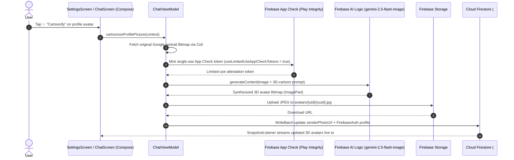

# Slacker — Zero-Backend, Production-Secured Client-Side AI Chat App

[](https://firebase.google.com/docs/ai-assistance/agent-skills)
[](https://firebase.google.com/docs/ai-assistance/agent-skills)

> *"Where work (doesn't) happen."*

**Slacker** is a Slack-inspired Android team chat application built with **Jetpack Compose** and **Firebase** to demonstrate how to ship **client-side generative AI features safely in production—without operating a custom backend server**.

Built for [`#FirebaseFactFridays`](https://www.linkedin.com/posts/arthur-thompson-02a275258_firebasefactfridays-activity-7494086220809990144-Y2mZ) and Android security architecture demos, Slacker pairs **multimodal image-to-image avatar generation (`gemini-2.5-flash-image` / Nano Banana)** via **Firebase AI Logic** with **Firebase App Check + Play Integrity limited-use tokens** to block scripted cURL and token-replay attacks.

---

## 🤖 Built with Gemini & Firebase Agent Skills

Slacker was developed with **Gemini** as the AI coding agent, powered by **[Firebase Agent Skills](https://firebase.google.com/docs/ai-assistance/agent-skills)** (`firebase-ai-logic`, `firebase-auth-basics`, `firebase-firestore`, and `firebase-security-rules-auditor`) to implement current Firebase AI Logic SDK idioms, App Check limited-use token attestation, Compose `FirebaseAuthScreen` onboarding, and real-time Firestore synchronization.

👉 **Learn how to add Firebase Agent Skills to your AI coding workflow:**  
**[https://firebase.google.com/docs/ai-assistance/agent-skills](https://firebase.google.com/docs/ai-assistance/agent-skills)**

---

## ✨ Key Architectural Highlights

| Pillar | Implementation Details | Source Files |
| :--- | :--- | :--- |
| **1. Replay-Protected Client-Side AI (`useLimitedUseAppCheckTokens`)** | Initializes `Firebase.ai` with `useLimitedUseAppCheckTokens = true` alongside **Play Integrity** (release) and **DebugAppCheckProvider** (debug). Every AI request consumes a single-use cryptographic App Check token—intercepted cURL replays fail with `403 Forbidden`. | [`SlackerApplication.kt`](app/src/main/java/com/example/arthurthompson/slacker/SlackerApplication.kt), [`ChatViewModel.kt`](app/src/main/java/com/example/arthurthompson/slacker/ui/ChatViewModel.kt) |
| **2. Multimodal 3D "Cartoonify" Avatar Pipeline (`gemini-2.5-flash-image`)** | Pulls the user's authentic Google Sign-In portrait (`providerId == "google.com"`), downloads a software `Bitmap` via Coil, and invokes **Nano Banana** (`gemini-2.5-flash-image`) with `ResponseModality.TEXT` + `ResponseModality.IMAGE` to synthesize a pastel 3D-cartoon avatar preserving the user's likeness. | [`ChatViewModel.kt`](app/src/main/java/com/example/arthurthompson/slacker/ui/ChatViewModel.kt), [`SettingsScreen.kt`](app/src/main/java/com/example/arthurthompson/slacker/ui/SettingsScreen.kt) |
| **3. Real-Time Profile & `#general` Chat Propagation** | Uploads the generated avatar JPEG to **Cloud Storage** (`avatars/{uid}/{uuid}.jpg`), updates `FirebaseAuth` (`UserProfileChangeRequest`), and executes a **Cloud Firestore `WriteBatch`** across the user's messages so active `#general` threads reflect the new 3D avatar immediately. | [`ChatViewModel.kt`](app/src/main/java/com/example/arthurthompson/slacker/ui/ChatViewModel.kt), [`ChatScreen.kt`](app/src/main/java/com/example/arthurthompson/slacker/ui/ChatScreen.kt), [`Message.kt`](app/src/main/java/com/example/arthurthompson/slacker/model/Message.kt) |
| **4. Trust-First Compose Onboarding (`firebase-ui-auth` 10.x)** | Uses the modern Jetpack Compose `FirebaseAuthScreen` + `authUIConfiguration` DSL (`AuthProvider.Google`) with a custom Material 3 method picker layout—hydrating initial display name and portrait photo on first tap. | [`SignInScreen.kt`](app/src/main/java/com/example/arthurthompson/slacker/ui/SignInScreen.kt), [`MainActivity.kt`](app/src/main/java/com/example/arthurthompson/slacker/MainActivity.kt) |

---

## 🏗️ End-to-End Architecture



---

## 🔍 Code Walkthrough

### 1. Hardware Attestation & Replay Protection
In [`SlackerApplication.kt`](app/src/main/java/com/example/arthurthompson/slacker/SlackerApplication.kt), Firebase is initialized on app startup and immediately bound to `PlayIntegrityAppCheckProviderFactory` for production builds (and `DebugAppCheckProviderFactory` for local development):

```kotlin
FirebaseApp.initializeApp(this)

if (BuildConfig.DEBUG) {
    Firebase.appCheck.installAppCheckProviderFactory(
        DebugAppCheckProviderFactory.getInstance()
    )
} else {
    Firebase.appCheck.installAppCheckProviderFactory(
        PlayIntegrityAppCheckProviderFactory.getInstance()
    )
}
```

In [`ChatViewModel.kt`](app/src/main/java/com/example/arthurthompson/slacker/ui/ChatViewModel.kt), **Firebase AI Logic** opts into **limited-use App Check tokens** so high-cost image generation calls cannot be replayed outside the attested app binary:

```kotlin
private val ai = Firebase.ai(
    backend = GenerativeBackend.googleAI(),
    useLimitedUseAppCheckTokens = true
)
```

### 2. Multimodal Image-to-Image Cartoonification (`Nano Banana`)
When the user taps the ✨ (`AutoAwesome`) button in [`SettingsScreen.kt`](app/src/main/java/com/example/arthurthompson/slacker/ui/SettingsScreen.kt), `ChatViewModel` always resolves the original `google.com` provider photo URL (preventing generational degradation across repeated runs) and invokes `gemini-2.5-flash-image`:

```kotlin
private suspend fun performCartoonization(input: Bitmap): Bitmap? {
    val model = ai.generativeModel(
        modelName = "gemini-2.5-flash-image",
        generationConfig = generationConfig {
            responseModalities = listOf(ResponseModality.TEXT, ResponseModality.IMAGE)
        }
    )

    val prompt = content {
        image(input)
        text(
            """
            A portrait of the person in the image in 3D-cartoon style with a blurred background.
            A cute and lovely character, with a smiling face, looking at the camera, pastel color tone.
            """.trim()
        )
    }

    val response = model.generateContent(prompt)
    return response.candidates.firstOrNull()?.content?.parts
        ?.filterIsInstance<ImagePart>()
        ?.firstOrNull()
        ?.image
}
```

### 3. Atomic Profile & Chat Sync
Once `gemini-2.5-flash-image` returns the synthesized `Bitmap`, [`ChatViewModel.kt`](app/src/main/java/com/example/arthurthompson/slacker/ui/ChatViewModel.kt) uploads it to Cloud Storage (`avatars/$uid/${UUID.randomUUID()}.jpg`), updates `FirebaseAuth.currentUser`, and commits a Firestore `WriteBatch` updating `senderPhotoUrl` across all messages authored by `senderUid`—instantly refreshing the live `#general` stream in [`ChatScreen.kt`](app/src/main/java/com/example/arthurthompson/slacker/ui/ChatScreen.kt).

---

## 🛠️ Tech Stack

- **UI**: Kotlin `2.2`, Jetpack Compose (BOM `2026.02.01`), Material 3, Navigation Compose, Coil (`coil-compose`)
- **AI**: Firebase AI Logic (`com.google.firebase:firebase-ai`, Firebase BOM `34.17.0`) — `gemini-2.5-flash-image`
- **Security**: Firebase App Check (`PlayIntegrity` + `Debug` providers, `useLimitedUseAppCheckTokens = true`)
- **Auth & Data**: `firebase-ui-auth` Compose (`10.0.0-beta03`), Firebase Auth (Google Sign-In), Cloud Firestore, Cloud Storage

---

## 🚀 Getting Started

### 1. Clone the repository
```sh
git clone https://github.com/kroikie/slacker.git
cd slacker
```

### 2. Configure Firebase
1. Create a project in the [Firebase Console](https://console.firebase.google.com/).
2. Register an Android app with package name `com.example.arthurthompson.slacker` and add your debug/release **SHA-1 & SHA-256** signing fingerprints (required for Google Sign-In and Play Integrity).
3. Download `google-services.json` and place it at `app/google-services.json` (gitignored by default).
4. Enable the following services in the Firebase Console:
   - **Authentication**: Enable the **Google** sign-in provider.
   - **Firebase AI Logic**: Enable the **Gemini Developer API**.
   - **Cloud Firestore**: Create the `(default)` database.
   - **Cloud Storage**: Enable Storage for `avatars/{uid}/*` uploads.
   - **App Check**: Register the app with **Play Integrity**, enforce App Check (including limited-use token enforcement for Firebase AI Logic), and register your Logcat `DebugAppCheckProvider` token under **Manage debug tokens** when testing on an emulator or debug build.

### 3. Build & Run
Open the project in **Android Studio** or build from the command line:
```sh
./gradlew assembleDebug
```
